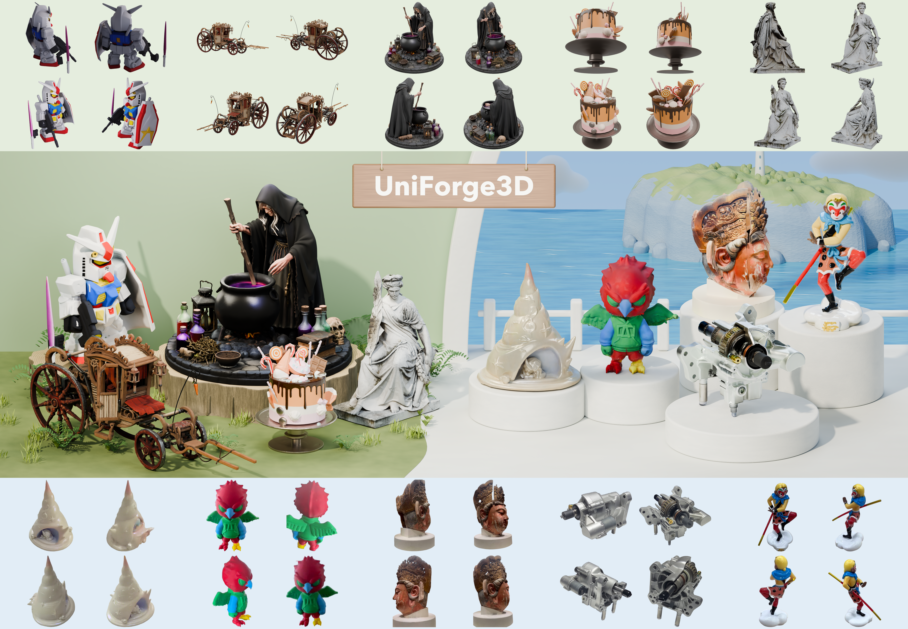

# UniForge3D: Joint 3D Reconstruction and Generation in a Shared Anchor-Guided Space

[](https://xishuxishu.github.io/uniforge3d-project/)
[](https://huggingface.co/xibushu/UniForge3D)




UniForge3D generates complete 3D assets from sparse, unposed multi-view images. It jointly models reconstruction and generation in a shared anchor-guided space, then uses structure-guided view selection to preserve observed details. 

## Installation

```bash
git clone https://github.com/xibushu/UniForge3D.git
cd UniForge3D
bash setup.sh
conda activate uniforge3d
```

## Inference

Place the views of each object directly in a separate folder under `assets/`:

```text
assets/
├── case01/
│   ├── 001.png
│   ├── 002.png
│   ├── 003.png
│   └── 004.png
└── case02/
    └── ...
```

Run all cases using the pretrained model:

```bash
python infer.py
```


## Citation

```bibtex
@misc{chen2026uniforge3d,
  title={UniForge3D: Joint 3D Reconstruction and Generation in a Shared Anchor-Guided Space},
  author={Chen, Wenjue and Chen, Wenyue and Zheng, Heliang and Jia, Rongfei and Liu, Yuan and Li, Meng},
  year={2026}
}
```

## Acknowledgements

Built on [TRELLIS.2](https://github.com/microsoft/TRELLIS.2) and [VGGT](https://github.com/facebookresearch/vggt).
